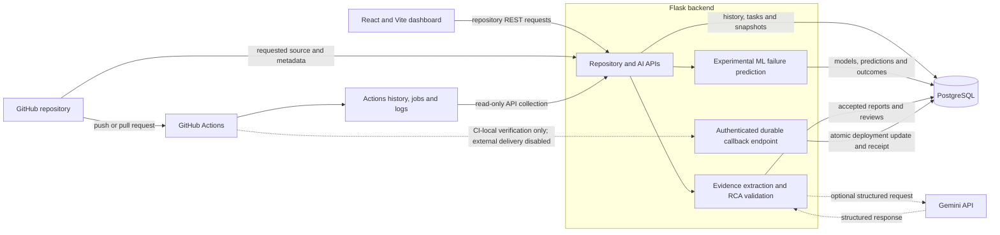

# Cloud-ByteXL

**AI-Powered DevOps Intelligence Platform**

Understand what changed, why a pipeline failed, and what historical workflow data can tell you about the next run. Cloud-ByteXL brings repository analysis, evidence-grounded failure diagnosis, experimental failure prediction, and durable CI status persistence into a Flask/PostgreSQL backend with a React dashboard.

[](https://github.com/saksham-1326/Cloud-Byte-XL-Project/actions/workflows/ci.yml)


**Verified checkpoint — November 20, 2026:** [174 backend tests passed on `main`](https://github.com/saksham-1326/Cloud-Byte-XL-Project/actions/runs/44762894885), including PostgreSQL 17, migration upgrades, callback persistence after a Flask restart, and Docker verification. This checkpoint belongs to merge commit [`a476582`](https://github.com/saksham-1326/Cloud-Byte-XL-Project/commit/a4765826fa8526b97c159ac3b93d2b65bb993ebb); it is not a permanent test-count or model-accuracy claim.

> **Development status:** The backend AI services and durable callbacks are implemented. Prediction remains experimental. External callback delivery is disabled. The merged React application supports repository analysis; dedicated AI dashboard wiring and further frontend/Figma integration remain pending.

**Explore:** [Overview](#project-overview) · [Features](#key-features) · [Prediction](#ai-feature-1--pipeline-failure-prediction) · [RCA](#ai-feature-2--root-cause-analysis) · [Architecture](#system-architecture) · [Setup](#installation-and-setup) · [Testing](#testing-and-cicd) · [Callbacks](#durable-ci-callbacks) · [Technical contributions](#final-year-project-context-and-technical-contributions)

## Project Overview

A failed CI run often leaves developers switching between source changes, workflow steps, job logs, deployment records, and local assumptions. A red status alone does not establish whether tests failed, a dependency was missing, or a later reporting command obscured the original problem.

Cloud-ByteXL combines four complementary capabilities:

1. **Repository context:** inspect source, configuration, infrastructure declarations, and static security findings.
2. **Historical workflow intelligence:** collect GitHub Actions executions, attempts, jobs, steps, and available failed-job logs.
3. **Failure explanation:** extract traceable evidence and produce a rule-based or provider-assisted root-cause report.
4. **Experimental prediction and durable status:** evaluate pre-execution failure risk separately from actual outcomes, and persist authenticated terminal callbacks against an explicitly associated deployment.

The project is an engineering prototype with measurable backend verification. It does not claim production deployment, autonomous remediation, or proven model generalization.

## Key Features

| Capability | Status | What exists today |
| --- | --- | --- |
| GitHub repository analysis | Implemented | Repository connection, metadata/source retrieval, file inventory, technology detection, heuristic health scores, findings, and recommendations. |
| Infrastructure and security inspection | Implemented, static | Evidence from Docker, GitHub Actions, Kubernetes, Terraform, CloudFormation/SAM, Bicep, and related configuration. Checks include permissive ingress, wildcard permissions, runtime users, moving image/action references, and possible committed credentials. |
| React dashboard | Implemented, partial integration | Repository connection updates overview/findings/security/architecture/report data. The committed CI/CD view still uses mock stages/history, and the Analysis-page progress is timer-driven. Dedicated AI UI integration is pending. |
| Actions history collection | Implemented | Incremental ingestion by repository/run/attempt, historical commit/configuration snapshots, log redaction, and explicit handling of inaccessible logs. |
| Root-cause analysis | Implemented, bounded validation | Deterministic diagnostics, optional Gemini/OpenAI providers, evidence citations, local validation guards, stored reports, and human-review APIs. |
| Pipeline failure prediction | Experimental | Baseline/model comparison, chronological backtests, queued-run inference safeguards, and future-outcome matching. |
| Durable CI callbacks | Implemented and tested locally/in CI | Mandatory authentication, repository allowlist, explicit run/deployment binding, transactional receipts, idempotency, and restart persistence. External delivery remains disabled. |
| Frontend/Figma integration and public callback deployment | Planned | Further integration and deployment require separate work and approval. |

Repository security checks are heuristics over bounded source inspection. They are not a complete secret scanner, dependency-vulnerability service, live cloud-account audit, or compliance certification. Inferred architecture and health scores describe repository evidence, not verified running infrastructure.

### Backend API surface

| Area | Selected routes |
| --- | --- |
| Health and database | `GET /`, `GET /api/database/test`, `GET /api/database/stats` |
| Repository analysis | `POST /api/github/repository`, `GET /api/github/repository/latest`, `POST /api/github/file` |
| Existing deployment history | `GET /api/deployments`, `GET /api/deployment-logs`, `GET /api/deployments/<deployment_id>/logs`, `GET /api/failures` |
| AI reads | `GET /api/ai/v1/overview`, `/runs`, `/models`, `/predictions`, `/outcomes`, `/evaluation`, `/rca` |
| AI work submission | `POST /api/ai/v1/sync`, `/train`, `/predictions`, `/rca`; poll `GET /api/ai/v1/tasks/<task_id>` |
| Human review | `POST /api/ai/v1/rca/<report_id>/verify` |
| Signed workflow observation | `POST /api/ai/v1/webhook` |
| Durable callbacks | `POST /api/ci/v1/status`, `GET /api/ci/v1/receipts/<receipt_id>` |

Short AI route suffixes in the table share the `/api/ai/v1` prefix. AI requests identify the repository with `repository=owner/repository` in a query or JSON body. Submission routes return HTTP 202 and a durable task ID. Local AI administration is restricted to trusted loopback requests when no administrator token is set; configured administration uses `X-AI-Admin`. The signed workflow webhook and bearer-authenticated callback endpoint have separate authorization rules.

## AI Feature 1 — Pipeline Failure Prediction

**Problem:** Can information available before execution help prioritize attention to a queued workflow without looking at its eventual result?

### Historical data and features

The collector reads GitHub Actions history and fetches commit/configuration snapshots at each run's exact SHA. Feature engineering includes:

- Changed-file counts, additions/deletions, and dependency/Docker/workflow change indicators.
- Historical workflow configuration availability and line count.
- Earlier completed same-workflow failure rates, failure streaks, and duration statistics.
- Trigger type, workflow identity, and UTC prediction-time hour/weekday.

Target logs, failed jobs, target duration/conclusion, and contemporary security scores are excluded. Same-commit siblings are excluded from historical context. Training uses first attempts and labels only `success` and `failure`; cancelled, timed-out, skipped, and other conclusions are not silently relabeled.

### Models and evaluation

The implementation compares **DummyClassifier**, **Logistic Regression**, and a small **Random Forest** using scikit-learn. `DictVectorizer` and train-only standardization form the preprocessing pipeline. Chronological 60/20/20 partitions purge overlapping commits, and outcome-availability checks reduce temporal leakage. Validation selects the model and decision threshold; the test interval evaluates every comparator.

Reported measures include precision, recall, F1, confusion matrix, accuracy, PR-AUC/ROC-AUC where defined, Brier score, and descriptive calibration bins. Undefined metrics remain unavailable. Insufficient independent samples or class diversity produce `insufficient_data`, not an invented probability.

### Predictions versus outcomes

Live shadow prediction requires GitHub to report the exact attempt as **queued**. The backend fetches the run itself, collects as-of features, and rechecks its status/SHA/attempt before saving a prediction. Completion synchronization matches persisted decisions with real outcomes and checks prediction timing against job start time.

Historical backtests and genuine live predictions are stored separately. A retrospective backtest must never be presented as a prediction made before that historical run. Model artifacts are server-owned, versioned, and hash-checked before loading.

**Prospective verification boundary:** the November 20, 2026 read-only audit of this project's local PostgreSQL records found **zero persisted shadow predictions** and therefore no matched prospective outcomes. Its 12 stored predictions were historical backtests across two model versions. Queued-run checks and outcome matching are implemented and regression-tested, but that is not a demonstrated real-world prospective evaluation. Fast workflows may not provide a usable queued window.

The latest stored model using feature version `prequeue-v2-utc-standardized` selected Logistic Regression from the three comparators. Its recorded historical evaluation was:

| Local registry evidence | Recorded value |
| --- | --- |
| Eligible historical runs / train / validation / test | 27 / 16 / 5 / 6 |
| Held-out historical accuracy | 0.50 |
| Held-out failure precision / recall / F1 | 0.00 / 0.00 / 0.00 |
| Probability calibration | Not fitted; descriptive bins and Brier score only |

These values were read from the existing local model registry and matched its generated evaluation artifact; the fitted model artifact also matched its stored SHA-256 digest. They describe **six held-out runs**, not production performance or a version-controlled benchmark dataset. The data is repository-specific and includes deliberately induced failures. No probability-calibration fitting step is implemented, and no calibrated probability or guaranteed prediction coverage is claimed. See [the implementation](backend/ai_intelligence/ml.py) and [AI verification notes](backend/AI_INTELLIGENCE.md).

## AI Feature 2 — Root-Cause Analysis

**Problem:** Explain the failed command using evidence, while distinguishing primary failure from subsequent cleanup or status-reporting errors.

The implemented flow is:

1. Retrieve job/step metadata and available failed-job logs through the read-only GitHub Actions client.
2. Redact configured secrets and common credential patterns before storing or sending evidence.
3. Normalize logs, preserve source line references, and extract command frames, process exits, test summaries, and diagnostic messages.
4. Generate a deterministic evidence-rule diagnosis, or request structured output from an explicitly configured provider.
5. Validate schema, failed-step identity, evidence citations, category indicators, and bounded factual constraints. Reject unsupported claims rather than silently replacing the provider's answer.
6. Persist accepted reports in PostgreSQL with their engine/model and human-verification status.

Secret redaction is best effort over configured values and recognized patterns; it is not proof that every possible sensitive value has been removed. The evidence and semantic guards are similarly bounded.

Supported categories cover intentional workflow termination, test/dependency/compiler failures, Docker/Kubernetes/workflow configuration issues, missing environment variables, authentication/permission failures, network/service failures, and `insufficient_evidence`.

### Gemini and verification status

The recorded November 15, 2026 checkpoint used **`gemini-3.5-flash-lite`**, which also remained the configured local model at this README's review. Saved generation/audit records and committed response fixtures document four fresh responses. An **agent assessment against frozen expectations** judged the primary cause/category correct on all four previously examined cases, while one response was rejected by the final guard for an unsupported secondary claim. These are recorded historical results, not fresh provider calls made during this fact-check, independent human judgments, or a production accuracy benchmark.

The November 20 local database audit found six stored Gemini-grounded reports, four failed-job records with stored log text, and **zero human-review submissions** for this project. All 21 stored RCA reports, including evidence-rule reports, were marked `unverified`. These aggregate records support persistence and historical use; they do not establish present model availability, complete secret redaction, or general diagnostic accuracy.

Gemini requests use bounded evidence, structured JSON output, and no tool execution, automatic provider fallback, or automatic retry. `RCA_PROVIDER=none` runs clearly labeled evidence rules with no LLM call. An OpenAI provider is also implemented but is not required for setup or CI.

Human review records category, step, evidence, fix, and unsupported-claim judgments. Reviewer identities are self-reported local-admin identifiers; agreement requires multiple reviewers and does not prove reviewer independence. Local guards are bounded pattern checks, not general semantic proof. See [RCA code](backend/ai_intelligence/rca.py), [fact validation](backend/ai_intelligence/rca_facts.py), and [the recorded evaluation](backend/AI_INTELLIGENCE.md).

## System Architecture



The dotted callback path is exercised by isolated sender/Flask/PostgreSQL tests inside CI. It does **not** represent a deployed public endpoint. Durable callback association is provisioned by trusted local administration. The optional signed workflow-observation route is separate from durable status delivery; no public webhook or tunnel is provisioned by this repository setup.

## Technology Stack

| Layer | Technologies in the repository |
| --- | --- |
| Frontend | React 19, Vite 8, Tailwind CSS 3, Recharts, Lucide React |
| Backend | Python 3.13, Flask, Flask-CORS, python-dotenv |
| Storage | PostgreSQL; psycopg 3 with binary distribution |
| Machine learning | scikit-learn, NumPy, joblib |
| RCA | Deterministic Python evidence rules, optional Gemini Developer API or OpenAI Responses API, jsonschema |
| Verification | pytest, saved fixtures/mocks, PostgreSQL 17 integration tests |
| Delivery tooling | GitHub Actions and a Python 3.13 Docker image |

AWS, Azure, and Kubernetes configuration may be recognized in analyzed repositories; that does not mean Cloud-ByteXL is deployed to those services. Backend dependencies are defined in [requirements.txt](backend/requirements.txt); frontend dependencies are defined in [frontend-app/package.json](frontend-app/package.json).

## Installation and Setup

### Prerequisites

- Git and Python **3.13** for the verified backend environment.
- Node.js satisfying Vite's checked-in engine requirement: `^20.19.0 || >=22.12.0`, with npm.
- A local PostgreSQL server and its `psql`, `createuser`, and `createdb` command-line tools. PostgreSQL **17** is the verified CI version.
- Docker is optional for container checks and disposable database testing.

The commands below use **Windows PowerShell** from the repository root. The explicit virtual-environment interpreter avoids requiring an activation-script policy change.

### Clone and install the backend

```powershell
git clone https://github.com/saksham-1326/Cloud-Byte-XL-Project.git Cloud-ByteXL
Set-Location Cloud-ByteXL
py -3.13 -m venv backend/venv
.\backend\venv\Scripts\python.exe -m pip install -r backend/requirements.txt
.\backend\venv\Scripts\python.exe -m pip check
```

### Configure a local database

For a new local installation, create an application role and database. These commands prompt for PostgreSQL credentials; reuse an existing working role/database instead if already configured.

```powershell
createuser --host=127.0.0.1 --username=postgres --pwprompt cloud_bytexl_app
createdb --host=127.0.0.1 --username=postgres --owner=cloud_bytexl_app bytexl
```

Create the environment file only if it does not already exist:

```powershell
if (-not (Test-Path backend/.env)) {
    Copy-Item backend/.env.example backend/.env
}
notepad backend/.env
```

Set `DB_HOST=127.0.0.1`, `DB_PORT=5432`, `DB_NAME=bytexl`, `DB_USER=cloud_bytexl_app`, and your local `DB_PASSWORD`. Start with `RCA_PROVIDER=none` and `CI_CALLBACK_ENABLED=0`. The backend loads `backend/.env` independently of the current working directory; existing process environment values take precedence.

Apply the checked-in migrations:

```powershell
.\backend\venv\Scripts\python.exe -m backend.ai_intelligence.cli migrate
```

**Fresh-database boundary:** migrations 001–004 create the AI subsystem, and 005 creates callback bindings/receipts. They do **not** bootstrap the original `users`, `repositories`, `deployments`, `deployment_logs`, and `failure_analysis` tables. A complete legacy-schema bootstrap is not currently checked in. AI history/RCA storage can use the new schema, but original deployment-history features and durable deployment registration require those legacy tables and valid existing records. Preserve the original project database schema when upgrading; do not invent missing tables from UI examples.

### Start the backend on loopback

```powershell
.\backend\venv\Scripts\python.exe -m flask --app backend.app run --host 127.0.0.1 --port 5000 --no-reload --no-debugger
```

In another terminal, check the HTTP endpoint:

```powershell
Invoke-RestMethod http://127.0.0.1:5000/
```

The root HTTP check proves server startup, not database persistence. `GET /api/database/test` checks database connectivity. The loopback command above deliberately avoids publishing the server on all network interfaces.

### Start the existing React frontend

In a separate PowerShell terminal at the repository root:

```powershell
npm ci --prefix frontend-app
npm run dev --prefix frontend-app -- --host 127.0.0.1 --port 5173 --strictPort
```

Open [http://127.0.0.1:5173](http://127.0.0.1:5173). The frontend defaults to the backend at `http://127.0.0.1:5000`; `VITE_API_BASE_URL` can override that public API base URL before Vite starts. Never place GitHub, database, provider, or administrator secrets in a `VITE_*` variable.

To build the frontend package:

```powershell
npm run build --prefix frontend-app
```

The dedicated AI dashboard changes and additional styling are pending integration. A fresh clone should not depend on uncommitted local frontend assets or repository-root experimental Node files.

### Work with AI history through the CLI

After migrations and GitHub access are configured, these commands synchronize read-only workflow history and train an experimental model; they do not trigger Actions runs or request an LLM response:

```powershell
.\backend\venv\Scripts\python.exe -m backend.ai_intelligence.cli sync --repository saksham-1326/Cloud-Byte-XL-Project
.\backend\venv\Scripts\python.exe -m backend.ai_intelligence.cli train --repository saksham-1326/Cloud-Byte-XL-Project
```

The CLI also supports `rca` and `worker`. RCA can contact the selected provider when enabled, so it is not part of the default setup or CI. The API persists asynchronous tasks; the worker command recovers queued or expired-leased tasks after restarts. See [AI setup and operational notes](backend/AI_INTELLIGENCE.md) for the full interface.

## Environment Configuration

Use [backend/.env.example](backend/.env.example) as the template. All values below describe configuration, not bundled credentials. **Never commit `.env`, tokens, API keys, or database passwords.**

| Variable | Requirement and purpose |
| --- | --- |
| `DB_HOST`, `DB_PORT`, `DB_NAME`, `DB_USER`, `DB_PASSWORD` | Required for database-backed features. Configure a local application role; there is no hardcoded password fallback. |
| `GITHUB_TOKEN` | Optional for some public metadata; Actions log access and private repositories require suitable repository/Actions read permissions. Keep it server-side. |
| `RCA_PROVIDER` | `none` by default for deterministic evidence rules; `gemini` or `openai` explicitly selects a provider. |
| `RCA_MODEL` | Required only for a selected LLM provider; there is no automatic model fallback. |
| `GEMINI_API_KEY` | Required only with `RCA_PROVIDER=gemini`. Use only the intended free-tier project configuration. |
| `OPENAI_API_KEY` | Required only with `RCA_PROVIDER=openai`; not needed for default setup or tests. |
| `AI_ALLOWED_REPOSITORIES` | Comma-separated repository identities. Required for remote AI access and signed workflow observation; also restricts local requests when configured. |
| `AI_ADMIN_TOKEN` | Optional for trusted loopback AI access; when set, AI requests require `X-AI-Admin`. Remote administration requires this token and an allowlist. |
| `GITHUB_WEBHOOK_SECRET` | Required only for the optional HMAC-signed `/api/ai/v1/webhook` integration. Do not provision a public webhook during local setup. |
| `CI_STATUS_TOKEN`, `CI_ALLOWED_REPOSITORIES` | Required to accept durable callbacks. Authentication is mandatory on the versioned endpoint. |
| `CI_CALLBACK_ENABLED` | Leave `0`. The sender is disabled by default and no external sender step exists in CI. |
| `CI_STATUS_URL` | Leave unset. No public callback URL or tunnel is needed for the verified workflow. |
| `FLASK_DEBUG` | Keep `0` for the documented setup. |
| `CORS_ORIGINS` | Optional server setting; defaults allow the documented local frontend ports. |
| `VITE_API_BASE_URL` | Optional frontend API address, not a secret. Defaults to `http://127.0.0.1:5000`. |

Safe baseline values are:

```dotenv
DB_HOST=127.0.0.1
DB_PORT=5432
DB_NAME=bytexl
DB_USER=cloud_bytexl_app
DB_PASSWORD=<your-local-database-password>
RCA_PROVIDER=none
CI_CALLBACK_ENABLED=0
FLASK_DEBUG=0
```

Gemini is optional. The recorded model selection was `RCA_PROVIDER=gemini` with `RCA_MODEL=gemini-3.5-flash-lite`. The code checks an explicit reviewed model allowlist, but that list does not prove account billing tier or available free quota. Preserve the project's free-tier-only policy, do not enable billing or substitute paid services, and treat quota/provider failures as errors. CI makes no live Gemini or OpenAI calls.

## Testing and CI/CD

The complete backend command is:

```powershell
.\backend\venv\Scripts\python.exe -m pytest backend/tests/ -v
```

Equivalently, with the virtual environment's Python active: `python -m pytest backend/tests/ -v`.

Database tests require explicit `AI_TEST_DATABASE=1` and the dedicated local database/role `cloud_bytexl_ci_test` / `cloud_bytexl_ci`. Without that opt-in, database tests skip; that is not equivalent to the complete verified checkpoint. Test configuration disables dotenv loading and blocks unmocked urllib HTTP calls. The sender/restart test intentionally runs separate processes that communicate only over literal loopback with temporary credentials.

### Optional disposable local PostgreSQL test service

Use a separate PowerShell terminal and a disposable Docker database, not your development database. Replace the password placeholder with a throwaway test value; it is unrelated to application credentials.

```powershell
$env:PYTHON_DOTENV_DISABLED = "1"
$env:AI_TEST_DATABASE = "1"
$env:DB_HOST = "127.0.0.1"
$env:DB_PORT = "55439"
$env:DB_NAME = "cloud_bytexl_ci_test"
$env:DB_USER = "cloud_bytexl_ci"
$env:DB_PASSWORD = "<disposable-test-password>"
$env:POSTGRES_PASSWORD = $env:DB_PASSWORD
docker run --detach --name cloud-bytexl-test-postgres --publish 127.0.0.1:55439:5432 --env POSTGRES_PASSWORD --env POSTGRES_USER=cloud_bytexl_ci --env POSTGRES_DB=cloud_bytexl_ci_test postgres:17
```

Wait until PostgreSQL reports readiness; repeat this check if startup is still in progress:

```powershell
docker exec cloud-bytexl-test-postgres pg_isready --username=cloud_bytexl_ci --dbname=cloud_bytexl_ci_test
```

Then, in that same terminal:

```powershell
.\backend\venv\Scripts\python.exe -m backend.ai_intelligence.cli migrate
.\backend\venv\Scripts\python.exe -m pytest backend/tests/ -v
```

After testing, remove only the disposable container created above and close the dedicated test terminal:

```powershell
docker rm --force cloud-bytexl-test-postgres
Remove-Item Env:POSTGRES_PASSWORD
Remove-Item Env:DB_PASSWORD
```

### What GitHub Actions verifies

The existing [Cloud-ByteXL CI workflow](.github/workflows/ci.yml) runs on pushes to `main` and pull requests targeting `main`:

1. Start a health-checked PostgreSQL **17** service with isolated test credentials.
2. Set up Python **3.13**, install `backend/requirements.txt`, and run `pip check`.
3. Compile backend modules and explicitly apply migrations.
4. Run the complete backend suite, including deterministic AI/RCA fixtures and PostgreSQL integration tests.
5. Verify migration 005 upgrades a populated pre-005 schema without changing existing AI/deployment rows or prior migration checksums.
6. Exercise authenticated callbacks, concurrent/duplicate/conflicting deliveries, stale attempts, rollback, commit-time failure, database readback, and persistence across a real Flask process restart.
7. Build the Docker image, start the Flask container, poll its HTTP endpoint, and clean up the application and service containers.

The Docker HTTP smoke check is separate from PostgreSQL persistence verification. `.dockerignore` excludes secrets, local environments, logs, model artifacts, reports, and frontend files from the backend image context. Callback fixtures remove their temporary schemas and terminate their Flask processes; GitHub manages the disposable service container.

**Documented backend checkpoint:** [174 passing tests and successful Docker checks](https://github.com/saksham-1326/Cloud-Byte-XL-Project/actions/runs/44762894885) on November 20, 2026, at `a476582`. This is a fixed historical checkpoint, not a claim that it is the latest run. No public Flask server, external PostgreSQL host, paid AI service, or live provider request is required.

## Durable CI Callbacks

`POST /api/ci/v1/status` requires a bearer token and an allowlisted repository. Its payload contains `repository`, `run_id`, `attempt`, `commit_sha`, `delivery_id`, `workflow`, `status`, `build`, `tests`, and `docker`.

Before delivery, a trusted local operator must use [the registration tool](backend/tools/register_ci_execution.py) to associate the exact workflow run, SHA, current attempt, and existing deployment. A callback cannot create that association or substitute the globally latest deployment.

The backend validates and locks the association, then updates the deployment and creates its receipt in one PostgreSQL transaction. Only after commit does it return `persisted: true`, a receipt UUID, execution identity, deployment ID, and canonical payload digest. The sender validates this acknowledgment rather than accepting an arbitrary HTTP 200.

- **Identical delivery replay:** return the same receipt without another state update.
- **Reused delivery ID with altered payload:** reject the conflict.
- **Different terminal delivery for an already finalized attempt:** reject it.
- **Wrong run, commit, or unregistered/stale attempt:** reject without updating another deployment.
- **Old exact replay after a newer attempt:** acknowledge the original receipt without reverting the newer result.
- **Database or commit failure:** return a safe error without acknowledging persistence. A retry uses the same delivery ID to resolve uncertainty.

`GET /api/ci/v1/receipts/<receipt_id>?repository=owner/repository` reads the stored receipt with the same authentication and repository authorization. The original `/api/ci/status` route remains compatible but retains legacy semantics and is not the durable-delivery contract.

**External HTTPS delivery is not deployed or verified and stays disabled.** Current verification is isolated loopback communication inside tests. Registration is trusted local administration, not GitHub OIDC verification; the legacy dashboard's in-memory status is not automatically populated by versioned receipts. See [the durable callback guide](backend/DURABLE_CI_CALLBACKS.md) and [CI verification notes](backend/CI_VERIFICATION.md).

## Screenshots

Screenshots will be added after frontend integration and publication approval. Local screenshots and in-progress frontend artifacts are intentionally not published here.

## Project Structure

Selected version-controlled paths:

```text
Cloud-ByteXL/
├── README.md
├── Dockerfile
├── .dockerignore
├── .github/workflows/ci.yml
├── System_Architecture.md
├── backend/
│   ├── app.py
│   ├── ci_callbacks.py
│   ├── requirements.txt
│   ├── .env.example
│   ├── AI_INTELLIGENCE.md
│   ├── CI_VERIFICATION.md
│   ├── DURABLE_CI_CALLBACKS.md
│   ├── ai_intelligence/
│   │   ├── api.py
│   │   ├── cli.py
│   │   ├── collector.py
│   │   ├── github.py
│   │   ├── migrations.py
│   │   ├── ml.py
│   │   ├── rca.py
│   │   ├── rca_facts.py
│   │   ├── reviews.py
│   │   ├── service.py
│   │   └── store.py
│   ├── migrations/
│   │   ├── 001_ai_intelligence.sql
│   │   ├── 002_prediction_modes.sql
│   │   ├── 003_feature_versions.sql
│   │   ├── 004_rca_reviews.sql
│   │   └── 005_ci_callbacks.sql
│   ├── tests/
│   │   ├── conftest.py
│   │   ├── fixtures/
│   │   ├── test_ai_api_storage.py
│   │   ├── test_ai_collection.py
│   │   ├── test_ai_ml_rca.py
│   │   ├── test_app.py
│   │   ├── test_ci_callback.py
│   │   ├── test_ci_durable.py
│   │   ├── test_gemini_rca.py
│   │   └── test_rca_reliability.py
│   └── tools/
│       ├── audit_ai.py
│       ├── ci_callback.py
│       ├── register_ci_execution.py
│       ├── validate_live_rca.py
│       └── verify_ai.py
└── frontend-app/
    ├── package.json
    ├── package-lock.json
    ├── index.html
    ├── vite.config.js
    ├── tailwind.config.js
    ├── postcss.config.js
    ├── public/
    └── src/
        ├── App.jsx
        ├── App.css
        ├── index.css
        ├── main.jsx
        └── assets/
```

Generated model files, local environment files, validation reports, virtual environments, and unmerged frontend assets are not prerequisites supplied by this source tree.

## Final-Year Project Context and Technical Contributions

Cloud-ByteXL is structured as a final-year engineering project that connects web development, DevOps automation, relational data modeling, and applied AI. Its technical contributions center on integrating these concerns with explicit evidence, data provenance, and failure handling.

| Contribution | Implementation evidence |
| --- | --- |
| Repository-aware DevOps analysis | Source/configuration inspection and REST endpoints in [the Flask backend](backend/app.py), consumed by the React repository dashboard. |
| Reproducible workflow data collection | [Collector](backend/ai_intelligence/collector.py) and [GitHub client](backend/ai_intelligence/github.py) preserve repository/run/attempt identity and historical SHA context. |
| Leakage-aware experimental prediction | [ML pipeline](backend/ai_intelligence/ml.py) compares baselines and models with chronological splits; [service safeguards](backend/ai_intelligence/service.py) restrict live inference to queued attempts. |
| Evidence-grounded failure explanation | [RCA](backend/ai_intelligence/rca.py) and [fact validation](backend/ai_intelligence/rca_facts.py) separate primary and secondary evidence and reject unsupported provider output. |
| Reliable status persistence | [Durable callbacks](backend/ci_callbacks.py) and [migration 005](backend/migrations/005_ci_callbacks.sql) implement explicit deployment association, transactional receipts, and duplicate/conflict handling. |
| Verification of failure behavior | [Callback regressions](backend/tests/test_ci_durable.py) exercise concurrent requests, rollback, commit-time failures, populated-database upgrades, and actual process restarts. |

For project evaluation or a technical interview, a reproducible demonstration can connect a repository, explain a saved failure-log fixture, inspect an experimental model's evaluation limits, and show that one authenticated callback receipt survives Flask restart and replay. These demonstrations do not require a public server or a live paid AI request. The documented 174-test checkpoint provides reproducible implementation evidence alongside the measured limitations above.

## Limitations and Future Work

- **ML generalization:** collect more independent, naturally occurring workflow outcomes and evaluate genuine future queued predictions before making accuracy or calibration claims.
- **RCA validation:** expand independent datasets, human review, and cross-job causal analysis. A citation match alone does not establish that every claim follows from the evidence.
- **Frontend integration:** integrate the dedicated AI dashboard and approved frontend/Figma work; replace remaining illustrative UI defaults with verified data flows where appropriate.
- **Fresh installation:** provide a reviewed bootstrap/migration path for the original deployment tables. Existing AI/CI migrations are additive, not a complete application-database installer.
- **Callback operations:** separately evaluate remote HTTPS delivery, identity/secret lifecycle, and automatic trusted run registration. No tunnel or public endpoint is enabled by the current workflow.
- **Service hardening:** the current local-admin identity model, legacy endpoints, development server, and repository heuristics are not a production multi-tenant security boundary.
- **Further monitoring:** broaden operational metrics and AI evaluation without conflating static repository evidence, historical backtests, and real deployed runtime observations.

## Conclusion

Cloud-ByteXL demonstrates how source inspection, historical workflow data, machine learning, evidence-grounded diagnosis, and transactional status handling can work together in a DevOps tool. Its strongest verified foundation is the backend: explicit data provenance, reproducible regression tests, isolated database checks, and durable callback behavior. Further frontend integration and broader real-world evaluation will determine how effectively that foundation supports day-to-day development.

For deeper implementation details, read [AI Intelligence](backend/AI_INTELLIGENCE.md), [Durable CI Callbacks](backend/DURABLE_CI_CALLBACKS.md), and [CI Verification](backend/CI_VERIFICATION.md). The broader [System Architecture document](System_Architecture.md) records design intent; its cloud-service diagrams should not be read as proof of deployed infrastructure.

## Independent RCA manual review (2026-11-21)

Review-package links below point to local generated files, which are not checked
into Git. A clean checkout contains the frozen regression fixtures; generating
the actual package requires the preserved original input artifacts.

Start with the plain-English [review guide](backend/reports/independent_review/REVIEW_GUIDE.md).
It explains all four failures and compares the earlier and improved responses.
Agent suggestions are separate in `suggested_decisions.json`; actual decisions
and rubric answers remain null in the worksheet until a person reviews them.

The user-requested [ChatGPT-assisted recommendations](backend/reports/independent_review/assisted_recommendations.json)
are stored separately from the human worksheet. They reject both #13 responses,
reject earlier/accept improved #21, and leave earlier #23/#27 uncertain while
accepting the improved responses for the observed HTTP 404 only. Run #13's
compiler outcome and the exact server-side reasons for HTTP 404 remain unresolved.
These are not independent human verification and were not submitted to any API.

[Provisional assisted metrics](backend/reports/independent_review/provisional_assisted_metrics.json)
contain decision statistics only: 3 accept, 3 reject and 2 uncertain across
8 reports on 4 workflows. The rejection proportion is 3/6 among resolved
recommendations; the 2 uncertain decisions are excluded. Earlier session: 2
reject, 2 uncertain; improved session: 3 accept, 1 reject. These proportions
are not correctness or production accuracy scores. Criterion-level accuracy
metrics are not inferred from acceptance decisions.

Reproduce these two assisted artifacts with
`python -m backend.tools.assisted_rca_recommendations`. This command preserves the
human worksheet and all original responses and evidence. Validation including
`backend/tests/test_assisted_rca_recommendations.py` plus the four review/RCA test
files listed below passed **68 tests**, with external HTTP blocked by test fixtures.

The [review package](backend/reports/independent_review/REVIEW_PACKAGE.md) presents
preserved log excerpts, independent agent proposals, and eight saved Gemini
responses across runs #13, #21, #23 and #27. These are proposals for manual review,
not completed human validation. Historical artifacts also identify failed runs
#4 and #8 with unavailable logs. Database and GitHub connectivity were unavailable
during initial evidence preparation, so these are historical availability counts.

Fill in [human_worksheet.json](backend/reports/independent_review/human_worksheet.json)
only after reviewing each response. Unresolved judgments stay null. The offline
calculator in `backend/ai_intelligence/review_metrics.py` provides primary-cause,
category, failed-step, evidence, unsupported-claim, fix and rejection rates, each with its own
resolved sample size. No human reviews are prefilled; initial metric denominators
are zero and rates are null. Four runs from one repository cannot establish
production accuracy.

Metrics include separate earlier/improved source sessions and distinct workflow
counts. Only rows explicitly marked human and completed contribute. Unanswered
criteria stay null and are excluded per criterion; uncertain decisions are
counted separately and excluded from the accept/reject rejection denominator.
This supports incomplete evidence without guessing a pass or failure.

Rebuild the package with `python -m backend.tools.prepare_independent_review`.
The builder reads saved artifacts, preserves any existing manual worksheet, and
makes no network, provider, database or verification API calls. To calculate
metrics from the completed worksheet, use the command in the package. The
existing verification API lacks primary-cause and uncertain-decision fields;
do not submit uncertain rows through it. No real report was submitted for human verification.

Validation: `backend/venv/Scripts/python.exe -m pytest
backend/tests/test_review_metrics.py backend/tests/test_independent_review_package.py
backend/tests/test_rca_reliability.py backend/tests/test_gemini_rca.py -q` passed 66 tests. The root `.venv` lacks
`jsonschema` for the existing RCA tests; the backend environment has it.

Generated `backend/reports/` and `backend/ai_audit.json` are ignored and are not
part of the proposed evaluation commit. Offline package tests use the explicitly
frozen historical fixture `backend/tests/fixtures/independent_review_inputs.json`,
so they do not require local generated reports. Regenerating the actual review
package still requires the original saved source files; a clean checkout only
contains regression inputs, not a new human evaluation. Source hash checks
confirm the two original RCA session files are unchanged. The human worksheet
has zero completed rows; no real report was submitted to the verification API.
Initial read-only access to the application database failed; the later isolated
test database is separate and does not verify its current state. Generated data
is excluded from the source commits. The reviewed RCA, ML reliability and
prospective verification changes are committed separately.

## ML historical audit and prospective plan (2026-11-21)

See [ML prediction audit](docs/ML_PREDICTION_AUDIT.md) for architecture, provenance,
leakage findings, the RCA commit scope and the prospective shadow implementation
plan. The saved historical dataset has **27 eligible runs: 21 success, 6 failure**,
split into **16 training / 5 validation / 6 test**. Recovered split class counts
are 13/3, 4/1 and 4/2 success/failure. These are historical records, not a fresh
database inventory; read-only database access was unavailable.

Reproduce the saved selected-model test scores and the DummyClassifier prior
baseline using `backend/venv/Scripts/python.exe -m backend.tools.replay_historical_ml`.
This replays saved probabilities and recovers the dummy training prior from
aggregate counts. It does not retrain or reconstruct missing training records.
The local saved logistic artifact also reproduced all six saved probabilities
when inspected read-only during the audit.

| Historical test metric (6 runs) | Selected logistic | Dummy prior |
| --- | ---: | ---: |
| Accuracy | 0.5 | 0.6666666667 |
| Precision / recall / F1 | 0 / 0 / 0 | 0 / 0 / 0 |
| PR-AUC (average precision) | 0.3333333333 | 0.3333333333 |
| Confusion matrix [[TN, FP], [FN, TP]] | [[3, 1], [2, 0]] | [[4, 0], [2, 0]] |

Both actual test failures were missed. The tiny validation sample contains only
one failure; its perfect validation F1 did not generalize. For #27, commit-size
features have large negative logistic contributions, explaining the extreme
low score without explaining the real HTTP failure. Runtime endpoint health is
not directly represented. No threshold was forced and no model was changed.

Feature tests verify exclusion of target outcome, duration, logs and errors,
and completion-time restrictions on history. The split helper now purges training
against the earliest surviving validation/test cutoff even when validation is
empty. The unchanged regression assertion now passes, with an additional exact
cutoff boundary test. Training still refuses insufficient partitions; the recorded
experiment had five validation rows. Historical feature availability and exact split
membership cannot be fully verified without the raw records.

Queued-run prediction, duplicate-resistant persistence, separate outcome joins
and timing validation already exist. Genuine prospective performance remains
unverified. Queued-state rechecks still race with run start; later reconciliation
must exclude at/after-start predictions and leave missing start evidence
unverifiable. No historical backtest is prospective evidence.

Follow-up [isolated shadow verification](docs/SHADOW_VERIFICATION.md): full backend
regression **212 passed, 0 failed, 0 skipped, 0 expected failures**, using a fresh
PostgreSQL 17 cluster on 127.0.0.1:55439 with database cloud_bytexl_ci_test and
role cloud_bytexl_ci. No personal or production database was contacted. ML regression:
**32 passed**; existing RCA regression: **68 passed**. All tests blocked unmocked
external HTTP; controlled lifecycle tests are not prospective accuracy evidence.
Focused PostgreSQL/shadow/callback suite: **60 passed, 0 failed, 0 skipped**.

The prediction service now rejects inconsistent identities and missing SHAs.
Persistence rejects stale completed-to-queued updates, mismatched commit metadata
and model/repository associations. Prediction insertion locks the eligible queued
run row through insertion; concurrent duplicates preserve one original prediction,
and outcome reconciliation preserves its original fields. Database rollback and
late/unverifiable timing exclusions are covered. There are no schema/migration,
provider, callback or frontend changes and no retraining/replacement of the saved
model. Generated reports and model artifacts remain excluded from commits.

A read-only GitHub check found 35 runs and no queued run. No workflow or failure
was manufactured. Genuine prospective prediction performance therefore remains
unverified; the next step is observing a naturally occurring eligible run and
its outcome. Historical accuracy and small-sample limitations remain unchanged.

## Live prediction readiness and proposed commit scopes

The [prospective prediction plan](docs/PROSPECTIVE_PREDICTION_PLAN.md) documents
the reviewed RCA/ML commit scopes and a step-by-step natural-run procedure with
independent read-only database readback. The reviewed scopes are recorded in
three focused source commits; publication and merge are separate actions.
Generated reports, secrets, model artifacts and unrelated frontend/root-package
changes are excluded from these commits and preserved locally.

The running Flask API creates the prediction service but does not automatically
watch GitHub. POST `/api/ai/v1/predictions` enqueues a task and submits it to the
API's executor. The signed `/api/ai/v1/webhook` handles `workflow_run` requested
and completed actions; it also accepts a queued action that GitHub does not
document for that event. GitHub's `in_progress` action is ignored, and requested
is not emitted for reruns. A separately started CLI worker polls **database
tasks**, not GitHub runs. There is no built-in periodic GitHub observer or CLI
predict command. See [GitHub workflow events](https://docs.github.com/en/actions/reference/workflows-and-actions/events-that-trigger-workflows#workflow_run).

A secret-safe check of local file/shell configuration found the GitHub token
present but webhook secret, repository allowlist and admin token absent. This
does not authenticate an already running process's environment or prove token
permissions. Webhook delivery and worker uptime are not established. Local
loopback administration can operate without an admin token; remote operation
requires deliberate authorization/allowlist setup. No settings were changed.

Before a genuine session, authenticate the existing model metadata/artifact,
prepare an approved dedicated observation database, run the API/recovery worker,
and approve either real webhook delivery or a bounded observer calling the
existing API. Preserve queued observation times, exact run/attempt/SHA, immutable
prediction fields and independent pre-start readback, then reconcile the actual
outcome. `predicted_at` is sampled before insertion; the existing matched flag
alone cannot prove pre-start database commit. The plan excludes cases lacking
independent timing evidence, even if that flag is matched.

Full backend rerun with isolated PostgreSQL: **212 passed, 0 failed, 0 skipped,
0 expected failures** (30 existing joblib/NumPy deprecation warnings). This covers
controlled persistence/concurrency, RCA and durable callbacks; no new live
observation was performed. Prospective prediction count for this task remains
**zero**, prospective metrics remain null, and historical accuracy is unchanged.
